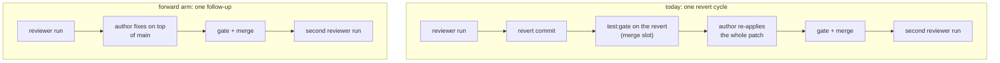

# Forward instead of backward: what a post-merge rejection should cost

Planned 2026-10-24 · requested by user (design discussion: "instead of reverting, would it be
possible to empower the reviewer role to make fixes directly and move forward instead of backward
on main?" — this document explores the forward-moving arms after the churn alert's own
miscount was filed). Supersedes nothing: it extends
[reviewer-as-role.md](reviewer-as-role.md) (the tiering that created post-merge review) and
[fast-merge.md](fast-merge.md) (D2 "revert first, fix forward second"), and it is the design half
of BUGS.md's 2026-10-23 six-revert entry.

## The problem

The tiering's stated payoff is not what the machinery delivers. reviewer-as-role.md, "The
problem", names the rejected class — "doc-comment misattributions, duplicate BUGS-FIXED.md
entries, commit-body-vs-diff claims — the class a post-merge review converts from 'hours of serial
rework' into **one follow-up fix**". What a post-merge rejection actually costs is a land →
review → revert → re-author → re-gate → re-merge → review cycle:

With this project's config (`check.gateCommand = "npm run test:gate"`, 600 s timeout) one rejection
costs:

- one reviewer run — the one-at-a-time post-merge review on a VERIFY_TIER permit
  (src/merge/merge-post-review.ts:25-44);
- a revert commit plus a **full `npm run test:gate` on the revert** and the fast-forward, all
  inside the single merge slot, serialized against merges (src/baseline/main-revert.ts:118-121,
  src/merge/merge-post-review.ts:26-42, src/merge/merge-drain.ts:216-224);
- an authoring run that re-applies the rejected patch from `refs/tumwater/rejected/<role>`
  (src/merge/merge-core.ts:396-424; docs/how-it-works.md:243-248);
- the follow-up's own gate, merge, and a second reviewer run — it is still an `afterMerge` change.

Measured in this repo: **12 post-merge rejections in the trailing day** (16 all time), 12
`tumwater(tumwater): Revert <sha>` commits since 2026-10-23, base-role split `dedupe 4, bugfix 4,
clean 2, organize 2`. Each of the 12 paid the whole chain above, including 12 `test:gate` runs on
reverts in the one merge slot.

## The machinery a forward arm can reuse

- `reviewMergedCommit` (src/review/post-merge-review.ts:95-168) reviews `git diff C^ C` in a
  **detached** checkout of C and writes `review_rejected` with `afterMerge: true` and `reasons`;
  nothing it writes is ever committed, and the harness owns every git operation (PRINCIPLES.md).
- `drainPostReviews` (src/merge/merge-post-review.ts:25-44) turns a rejected entry into a revert
  slot item `{commit, runner: role, failingTests: [], postReview: {reasons}}`.
- `runMainRevert` → `onReverted` = `handBackReverted` → `recordRevertedChange`
  (src/baseline/main-revert.ts:106-135): `state.lastReview = {verdict: "reverted", reasons, head}`,
  `refs/tumwater/rejected/<role>` → C, `state.revision = {sha, round, reasonCounts}` — the author's
  next run re-applies C with the reviewer's reasons in front of it.
- **The forward arm already exists as the failure path.** When the revert is skipped or fails
  (conflict, red gate, failed fast-forward), `onFailed` = `sendReviewToRole`
  (src/merge/merge-drain.ts:126-140) enqueues into the author's inbox: *"A review after merging
  rejected your commit <sha> on main, and it could not be reverted (<reason>). It is still on
  main. Fix what the reviewer found in a new change:"* plus the numbered reasons. Main keeps C; no
  revert, no revision record.
- Convergence: `REVISION_FINAL_ON_REPEAT = 2`, `REVISION_BACKSTOP = 6`
  (src/runner/revision.ts:34,44). `recordRevertedChange` counts rounds and clears the chain at the
  backstop, but — unlike `recordRejectedChange` (src/merge/merge-core.ts:340-390) — it never calls
  `holdEntryAfterExhaustion`, so an exhausted **post-merge** chain leaves its plan eligible for a
  fresh pick. The forward arm as written (`sendReviewToRole`) is counted by neither: no round, no
  backstop, no exhaustion.
- Exemption: a diff wholly under `review.exemptPaths` (`*.md`, `docs/**`) queues no post-merge
  review at all (`postReviewDue`, src/merge/merge-drain.ts:46-50) — the churn is code diffs whose
  *claims* are wrong, so widening the exemption cannot reach it.

## The arms

| Arm | Shape | Cost | What it breaks |
|---|---|---|---|
| A | The reviewer authors the fix | none extra to a reviewer run | Independence (the verdict must come from outside the author); it spends the scarcest permit — one review at a time, and review-side time is already the dominant friction (213 rejections vs 185 approvals; bugfix-2's 27 consecutive rejections over 6 h on one md edit, reviewer-as-role.md); two writers on one set of files ("one owner for a red main", fast-merge.md "What stays") |
| B | The reviewer returns a **minimal patch**; the author lands the follow-up | the reviewer's run grows by the patch | The patch may not apply once main moves (the author adapts it, its change its own); a `VERDICT` contract change touches every review prompt and the parser |
| C | **Fix-forward is the default** for post-merge rejections (promote `sendReviewToRole` to the normal path) | one authoring run + the follow-up's gate/merge/review; the merge slot is freed | Rejected content stands on main until the follow-up lands — safe for a doc claim, live-but-green for a behavioral one (BUGS.md's churn entry names `beac3bd1e` reverting `ec36ff29`, "drops `gitTryStarted`'s `gitCouldNotStart` throw and breaks `pickBase`'s documented contract"); no convergence accounting today; every surface that says "reverted" would lie (BUGS-FIXED.md:24-31 is exactly the entry about that) |
| D | **Split by cause**: revert for behavior/correctness, forward for claims/docs/consistency | one more verdict field, and the reviewer must judge it | The reviewer is adversarial by design and can name this reliably, but it is a new axis on the contract; deriving the class mechanically ("does the diff touch non-comment lines?") is not the same question |
| E | Route the editorial class to a designated fixer (**bugfix**) | bugfix already takes heal prompts and owns fix-forward | Authorship: the committing role owns its files and its plan entry (docs/cli.md's revert wording names the reverted commit's role as "the one that may redo the work"); bugfix does not carry the change's context; two writers while the author is mid-run |
| F | **Cut rejections at the source**: narrow `review.afterMerge` for the noisy role, or raise the authoring bar | config only | Re-buys the reviewer thrash the tiering was built to fix — the same 53% reject rate, now serial and pre-merge again |
| G | **Operator accept-unreviewed** (exists today: `tumwater reviews --accept <n>`, the dashboard's two-click Accept) | operator attention | Nothing structural; it is a per-entry override, not a policy |

## Measurement (2026-10-24): the trailing window's 11 rejections, classified

Landing order 1 below, done. The 11 `tumwater(tumwater): Revert <sha>` commits main took off in
the trailing day (`git log --grep="Revert [0-9a-f]"`), each classified from the reviewer's own
reasons in its body — the same 11 the `reverts off main` alert counts, because the alert's count
is these and not a red-main burst (BUGS.md's churn entry, "Diagnosis 2026-10-24").

| revert | base role | the reviewer's reasons, classified |
|---|---|---|
| `2d56b0a9` | bugfix | the diff removes nothing its summary names; a duplicate test; a comment contradicting its own assertions — editorial/claim |
| `a2eb229d` | bugfix | a fixed bug left under `## Open`; gate warnings without the `✖ ` glyph silently missed — **behavioral** |
| `b735cbd5` | bugfix | the body claims `RevertGuardrail` fields that are not in the diff; the branch is untested — **the stated change is absent** |
| `1c348fdf` | dedupe | an unclaimed second change; two falsified claims — editorial/claim |
| `c99611ca` | dedupe | no test exercises the restored throw; RISK unsupported — coverage |
| `beac3bd1` | dedupe | `gitTryStarted` → `gitTry` drops `gitCouldNotStart`, contradicting `pickBase`'s documented contract — **behavioral** |
| `4f9ed36b` | clean | the doc comment undercounts the fields the rule governs — editorial |
| `7c65c1b78` | organize | "only doc comments changed" against a ~200-line move; half-done cross-refs — editorial/claim |
| `a6616585` | organize | stale cross-references to the moved code's old home; stray blank lines — editorial |
| `2b05cb2e` | clean | half-applied at two twin sites; the new branch untested — editorial + coverage |
| `5d5e9196` | dedupe | the doc comment misattributes `ompNote` to the wrong check — editorial |

**8 of 11 are claim/doc/coverage slips** — a diff disagreeing with its own summary, a stale
cross-reference, an undercounted comment, a half-applied multi-site fix, an untested restore. All
eight are the class a forward follow-up repairs on top of main in one authoring run. **3 carry
something the forward arm would leave live on main** until the follow-up lands: `beac3bd1` (a
dropped `gitCouldNotStart` throw), `a2eb229d` (recurrences silently missed) and `b735cbd5` (a body
whose stated change is not in the diff).

## What could land, in order

1. **Measure first** (no code): classify the trailing window's rejections — behavioral vs
   editorial — from the `reasons` already in the log, by base role. This decides whether C is safe
   for the whole class or needs D's split. The churn alert cannot answer it today: its rows are
   runner ids, filed 2026-10-24 as BUGS.md's churn entry. **Done 2026-10-24 — see the Measurement
   section: 8 of 11 editorial.**
2. **Convergence accounting for any forward arm.** Give a forward fix the record a revert gets
   (`state.lastReview.verdict`, round counting, `REVISION_FINAL_ON_REPEAT`/`REVISION_BACKSTOP`)
   and the same terminal `exhausted` state — including the plan hold `recordRevertedChange` is
   missing today. Without this, C is an unbounded loop whose dead end is invisible to the operator.
3. **C gated by D**: forward for the editorial class, revert for anything behavioral. The revert's
   second job — a clean base to re-author against — is worth little for a one-line doc fix and a
   lot for a patch that must be re-applied whole.
4. **B, only if the measurement shows the fix is usually mechanical.** The reviewer holds the diff
   in context; that is the cheapest place in the system for the fix to exist. It is also the only
   arm that answers the user's original question ("empower the reviewer to make the fix") without
   handing the reviewer authorship — it proposes, the author commits.

## Acceptance (whichever arms are picked)

- A post-merge rejection of the editorial class leaves no revert commit and no `main_revert` event:
  `tumwater report`'s post-merge-rejection table and the churn alert still count it, and every
  surface reads "still on main", never "reverted".
- The forward fix consumes one authoring run and the follow-up's own gate + post-merge review — no
  `test:gate` run on a revert, no merge-slot hold.
- A forward chain that stops converging reaches the same terminal state a revision chain does, and
  the state is operator-visible (doctor/report), not silent.
- The behavioral class still reverts: pinned by a fixture whose reasons are behavioral.

## Open questions

1. Does the **reviewer's verdict** carry the class (D), or does the operator narrow
   `review.afterMerge` (F) and keep every post-merge rejection reverting? The trailing window's 12
   reason texts answer it. **The measurement (2026-10-24) answers it for the class: 8 of 11 are
   editorial — forwarding is right for the majority, and the 3 that are not are exactly the ones a
   revert protects. Whether the class gate (D) or the blanket forward (C — what PLANS.md's
   three-part series implements today) lands is the operator's call, and this measurement is the
   evidence either way.**
2. Is "main stays green but holds rejected content, until the follow-up lands" acceptable for a
   bounded window? The red-main watch cannot see it — the next post-merge review of the follow-up
   is the only check that will.
3. For arm B: does the patch belong in the verdict contract (every reviewer prompt changes) or in
   the rejection's hand-back text as prose (no parser change, the author re-derives it)?
